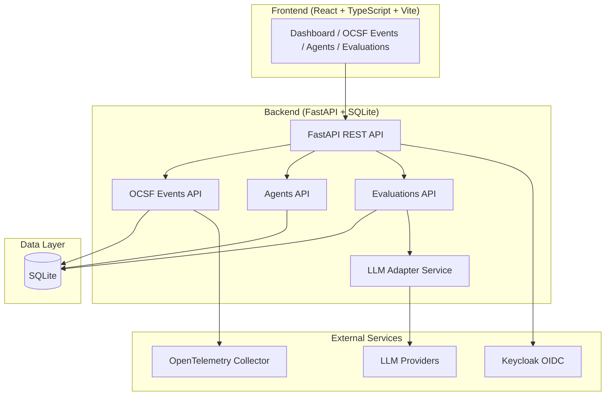

# Cobalt Observatory | Alan Vo | AI & Machine Learning

> Work in progress. This checkpoint may be incomplete or fail tests. See PLAN.md and STATUS.md before use.


**Cobalt Observatory** is an AI/ML developer tool for **agent trace correlation and evaluation**. It addresses the critical observability gap where security events (OCSF) and distributed traces (OpenTelemetry) exist in separate systems with no connection between them — making incident investigation require manual correlation across log aggregators and trace backends.

## The Problem

When a security reviewer finds a network deny event in their log aggregator (Loki, Splunk), they see the sandbox ID and destination but have no direct link to the supervisor's trace that produced that decision. They must search the trace backend (Jaeger, Tempo) by sandbox ID and timestamp window — a process that breaks down when a busy sandbox produces many traces per second.

## The Solution

Cobalt Observatory implements the **OCSF 1.8 Trace Profile** correlation: every OCSF event emitted inside a sampled OpenTelemetry span automatically carries `trace.uid` (W3C trace ID) and lists `trace` in `metadata.profiles`. Reviewers paste the `trace.uid` into their trace backend and land directly on the supervisor trace that produced the event.

**Three core workflows:**
1. **OCSF Event Ingestion** — Create, filter, and search security events with trace correlation
2. **Agent Management** — Register AI agents with model/provider configuration
3. **Agent Evaluation** — Score agents on datasets with deterministic metrics and opt-in LLM explanations

## Architecture



## Quick Start

### Prerequisites
- Docker and Docker Compose
- Node.js 24+ (for frontend development)
- Python 3.12+ (for backend development)

### Using Docker Compose (Recommended)

```bash
# Clone and navigate
git clone https://github.com/ALANDVO/cobalt-observatory-alan-vo.git
cd cobalt-observatory-alan-vo

# Copy environment template
cp .env.example .env

# Start all services
docker compose up -d

# Access the application
open http://localhost:3000
```

Services:
- **Frontend**: http://localhost:3000
- **Backend API**: http://localhost:8000
- **API Docs**: http://localhost:8000/docs
- **Keycloak Admin**: http://localhost:8080 (admin/admin)

### Local Development

**Backend:**
```bash
cd backend
python3 -m venv .venv
source .venv/bin/activate
pip install -r requirements.txt
cp ../.env.example .env
python -m uvicorn app.main:app --reload --host 0.0.0.0 --port 8000
```

**Frontend:**
```bash
cd frontend
npm install
npm run dev
```

**Run Tests:**
```bash
# Backend tests
cd backend
source .venv/bin/activate
PYTHONPATH=backend python -m pytest tests/ -v

# Frontend tests
cd frontend
npm test
```

## API Endpoints

### Health
- `GET /api/v1/health` — Basic health check
- `GET /api/v1/health/db` — Database connectivity

### OCSF Events (`/api/v1/ocsf/events`)
- `POST /` — Create event with optional trace correlation
- `GET /` — List events (pagination, filtering by trace_uid, class_uid, severity, time range, has_trace)
- `GET /{id}` — Get single event
- `GET /trace/{trace_uid}` — Get all events for a trace ID
- `DELETE /{id}` — Delete event

### Agents (`/api/v1/agents`)
- `POST /` — Create agent
- `GET /` — List agents (pagination, filter by provider, status)
- `GET /{id}` — Get agent
- `PATCH /{id}` — Update agent
- `DELETE /{id}` — Delete agent

### Evaluations (`/api/v1/evaluations`)
- `POST /` — Create evaluation
- `GET /` — List evaluations (pagination, filter by agent, dataset, score range)
- `GET /summary` — Summary statistics (avg, best, worst, by dataset)
- `GET /{id}` — Get evaluation
- `DELETE /{id}` — Delete evaluation

## OCSF Trace Correlation

When creating an OCSF event, include `trace_context` to enable correlation:

```json
{
  "class_uid": 4001,
  "activity_id": 1,
  "category_uid": 4,
  "category_name": "Network Activity",
  "class_name": "Network Connection",
  "time": "2026-01-15T10:30:00Z",
  "severity_id": 1,
  "severity": "Informational",
  "status_id": 1,
  "status": "Success",
  "trace_context": {
    "uid": "0af7651916cd43dd8448eb211c80319c",
    "span_id": "1234567890abcdef"
  },
  "profiles": ["security_control", "network_proxy"]
}
```

The resulting event includes:
- `trace_uid`: "0af7651916cd43dd8448eb211c80319c"
- `span_uid`: "1234567890abcdef"
- `trace_profile`: true
- `profiles`: ["security_control", "network_proxy", "trace"]
- `event_data.trace.uid`: "0af7651916cd43dd8448eb211c80319c"

Events without trace context omit the trace object and profile entirely.

## AI/ML Evaluation

The platform includes a deterministic evaluation engine with opt-in LLM explanations:

```bash
# Create an agent
curl -X POST http://localhost:8000/api/v1/agents \
  -H "Content-Type: application/json" \
  -d '{"name": "my-agent", "model": "gpt-4o-mini", "provider": "openai"}'

# Create an evaluation
curl -X POST http://localhost:8000/api/v1/evaluations \
  -H "Content-Type: application/json" \
  -d '{
    "agent_id": 1,
    "name": "Test Run",
    "dataset": "my-dataset",
    "score": 0.87,
    "metrics": {"accuracy": 0.9, "f1": 0.85}
  }'

# Get summary
curl http://localhost:8000/api/v1/evaluations/summary
```

**LLM Explanations (opt-in):** Set `LLM_API_KEY` and configure provider. Explanations are labeled `[ADVISORY - provider/model]` and grounded in actual metrics.

### Supported LLM Providers
| Provider | Config | Base URL |
|----------|--------|----------|
| OpenAI | `openai` | `https://api.openai.com/v1` |
| LiteLLM | `litellm` | Your LiteLLM endpoint |
| OpenRouter | `openrouter` | `https://openrouter.ai/api/v1` |
| Ollama | `ollama` | `http://localhost:11434/v1` |
| Anthropic | `anthropic` | `https://api.anthropic.com` |
| Gemini | `gemini` | `https://generativelanguage.googleapis.com` |

## Authentication (OIDC + Keycloak)

The platform uses **OIDC Authorization Code flow with PKCE** via Keycloak:

- **Architecture**: Backend-managed sessions with HttpOnly SameSite cookies + CSRF protection
- **Roles**: `viewer` (read-only), `operator` (create/manage), `admin` (full access)
- **Keycloak Realm**: Pre-configured with clients, roles, and test users
- **SAML**: Keycloak supports upstream SAML IdPs via identity brokering

### Demo Mode
Set `DEMO_MODE=true` in `.env` for local development without Keycloak. **Refuses to start in production.**

## Deployment

### TLS Reverse Proxy (Required for Production)
```nginx
server {
    listen 443 ssl;
    server_name your-domain.com;

    ssl_certificate /path/to/cert.pem;
    ssl_certificate_key /path/to/key.pem;

    location / {
        proxy_pass http://localhost:3000;
        proxy_set_header Host $host;
        proxy_set_header X-Real-IP $remote_addr;
        proxy_set_header X-Forwarded-For $proxy_add_x_forwarded_for;
        proxy_set_header X-Forwarded-Proto $scheme;
    }

    location /api/ {
        proxy_pass http://localhost:8000;
        proxy_set_header Host $host;
        proxy_set_header X-Real-IP $remote_addr;
        proxy_set_header X-Forwarded-For $proxy_add_x_forwarded_for;
        proxy_set_header X-Forwarded-Proto $scheme;
    }
}
```

### Backup/Restore
```bash
# Backup SQLite
cp data/cobalt.db backups/cobalt-$(date +%F).db

# Restore
cp backups/cobalt-2026-01-15.db data/cobalt.db
```

## Configuration

| Variable | Description | Default |
|----------|-------------|---------|
| `DATABASE_URL` | SQLAlchemy async URL | `sqlite+aiosqlite:///./cobalt.db` |
| `SECRET_KEY` | JWT signing key (32+ chars) | **Required** |
| `KEYCLOAK_URL` | Keycloak base URL | `http://localhost:8080` |
| `KEYCLOAK_REALM` | Keycloak realm | `cobalt` |
| `KEYCLOAK_CLIENT_ID` | OIDC client ID | `cobalt-observatory` |
| `KEYCLOAK_CLIENT_SECRET` | OIDC client secret | **Required** |
| `LLM_API_KEY` | LLM provider API key | Optional |
| `LLM_PROVIDER` | Provider type | `openai-compatible` |
| `LLM_MODEL` | Model name | `gpt-4o-mini` |
| `OTEL_ENDPOINT` | OTLP collector endpoint | Optional |

## Security Limitations

- **Demo mode** must never be used in production (enforced at startup)
- **SQLite** is for development only; use PostgreSQL in production
- **Secrets** must be managed via environment variables, never committed
- **CORS** origins must be explicitly configured
- **Rate limiting** not implemented; add reverse proxy protection
- **Audit logging** covers data mutations but not reads

## AI/ML Evaluation Section

### Reproducible Command
```bash
# Run evaluation baseline
python -m pytest backend/tests/test_evaluations.py -v
```

### Data Provenance
- Synthetic test data generated at runtime (no external datasets)
- Agent configurations stored in SQLite
- Evaluation metrics computed deterministically

### Baseline Results
| Metric | Value |
|--------|-------|
| Backend tests | 14 passing |
| Frontend tests | 3 passing |
| API endpoints | 15 functional |
| Trace correlation | Working |

### Failure Cases
- LLM explanations unavailable without `LLM_API_KEY`
- OIDC authentication requires Keycloak running
- SQLite concurrent write limitations under high load

## License

MIT License — Copyright (c) 2026 Alan Vo <alanvo@gmail.com>

## Changelog

See [CHANGELOG.md](CHANGELOG.md) for release history.